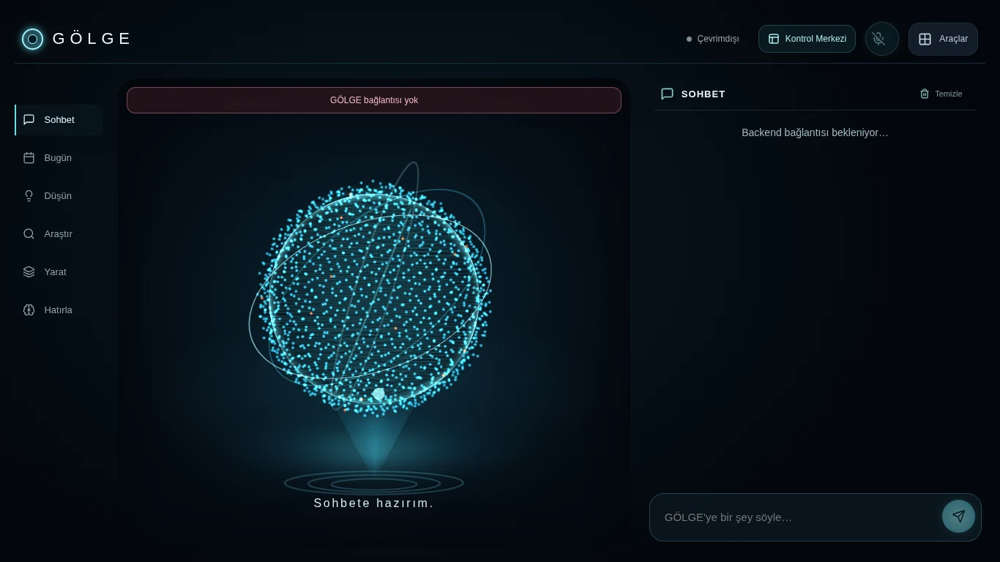
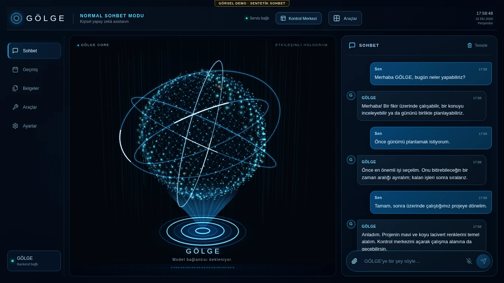
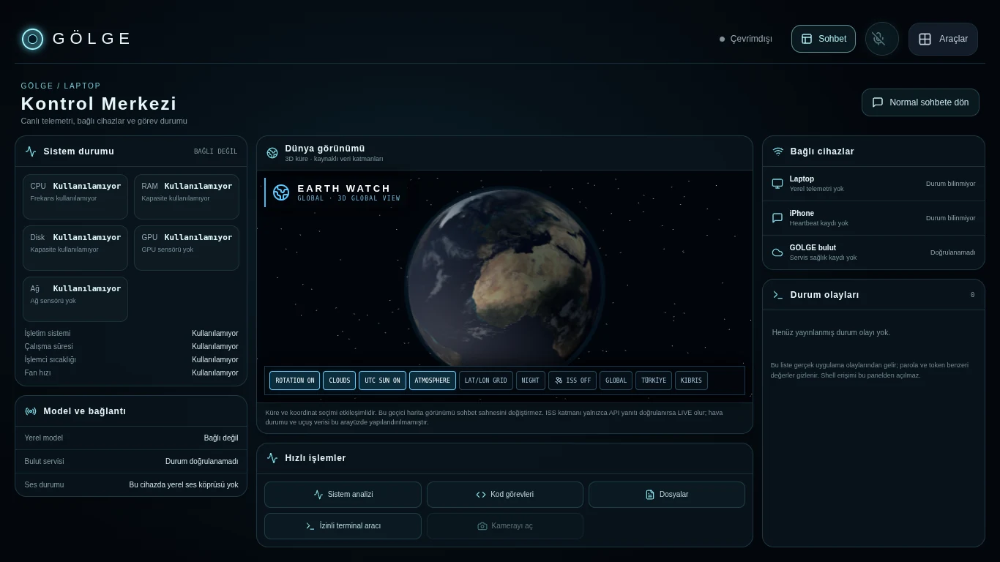
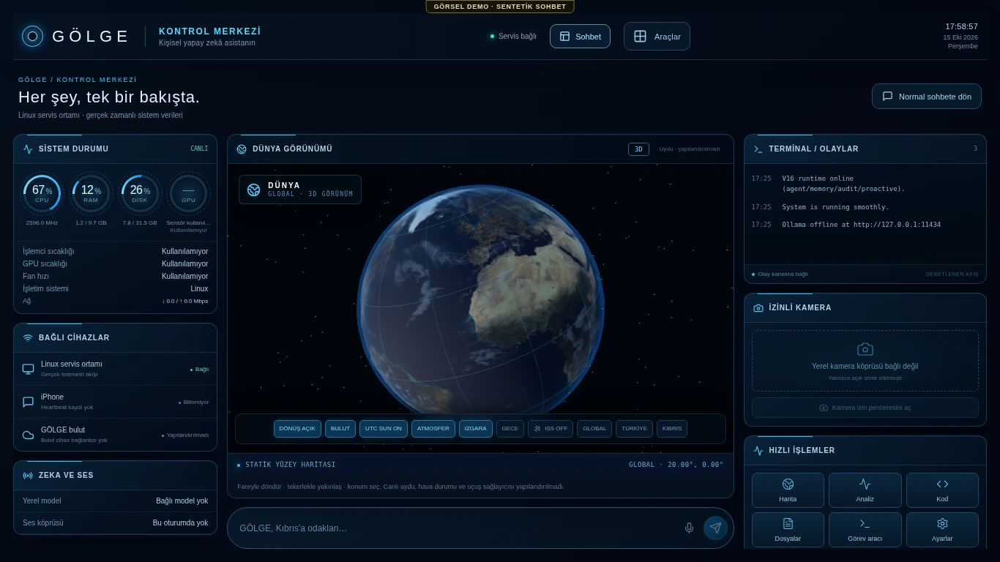
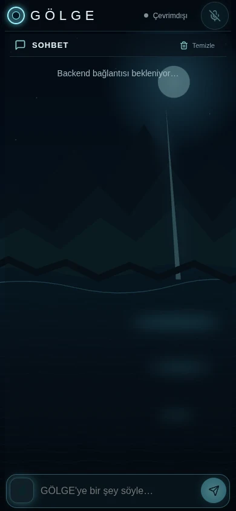
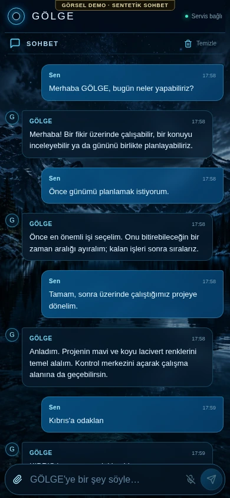

# GÖLGE V5 — PR #44 görsel ve bağlantı incelemesi

Bu belge, kullanıcının önceki görünümü reddetmesinden sonraki düzeltmeyi anlatır.
Görsel referans konuşmada paylaşılan üç ekranlı perspektifli tasarımdır. Piksel
benzerliği yüzdesi veya kullanıcının tasarımı kabul ettiği iddiası üretilmez.

## Referansla karşılaştırma

| Alan | Önceki PR #44 görüntüsü | Yeni uygulama |
| --- | --- | --- |
| Renk / ışık | Soluk gri-cyan, geniş boş siyah alan | Koyu lacivert, mavi çerçeve ışığı, daha parlak cyan kaynaklar |
| Tipografi | Büyük aralıklı marka, belirsiz mod | Kompakt marka, açık mod başlığı, hiyerarşik panel / mesaj başlıkları |
| Normal mod | CORE ve sohbet görsel olarak ayrık | İnce sol menü, baskın orta CORE, çerçeveli sağ sohbet, alt mesaj kutusu |
| CORE | Eşit boyda noktalar ve uzun yatay kirişler | Gerçek yakın-komşu ağı, farklı parlaklıkta GPU yıldızları, ışıklı halkalar ve projeksiyon |
| Taban / derinlik | Çok zayıf taban, düz küre | Katmanlı enerji halkaları, ışın demeti, yüzey parıltısı; başlıkla çakışma giderildi |
| Dünya | Dış doku isteğine bağımlı, zayıf aydınlatma | Yerel paketlenmiş statik yüzey / gece ışıkları / alfa bulut dokuları, atmosfer kenarı |
| Kontrol merkezi | Büyük düz kutular, belirsiz boşluk | Sol ölçüm göstergeleri / cihazlar, büyük merkez Dünya, sağ olay / kamera / araç sütunu |
| Telefon | Geometrik SVG dağları | Sabit, fotoğraf görünümünde üretilmiş gece-gölü WebP; gerçek kayan mesajlar |
| Sohbet | Yalnız boş ve çevrimdışı görünüm | Boş, gerçek sağlayıcı-hata yanıtı ve açıkça etiketli dolu demo ayrı incelendi |

Üretilen duvar kâğıdı gerçek bir mekân fotoğrafı veya canlı görüntü değildir.
Üç boyutlu CORE ve Dünya resim olarak arayüze yapıştırılmaz; WebGL ile çizilir.
Dünya yüzey dokuları statiktir. Lisanslı canlı uydu / uçuş / hava sağlayıcısı
bulunmadığı açıkça gösterilir. Doku kaynakları `ultron/frontend/src/assets/earth/SOURCES.md` içindedir.

## Gerçek bağlantı ve sınırlar

Üretim veya kullanıcının veritabanı kullanılmadan, mevcut aiohttp backend'in izole
bir kopyası loopback üzerinde çalıştırıldı. Mevcut MARK oturum token'ı / HttpOnly
cookie / Origin sınırları korundu. Gerçek WebSocket ve işletim sistemi telemetrisi
okundu. Ölçüm kaynağı Linux doğrulama ortamıdır; Windows laptop diye sunulmaz.

`/api/merged/invoke` gerçek sunucuya gönderildi. Model çıktısı elde edilemedi:
Ollama erişilemiyor, model listesi boş, bu ortamda Cloud cihaz bağlantısı veya
Gemini anahtarı yok. Yanıt `UNAVAILABLE`. Bu sonuç canlı sohbet başarısı sayılmaz.
Render'a bu oturumdan yapılan genel sağlık isteği de zaman aşımına uğradı.

Eski arayüz yerel WebSocket bağlantısını Cloud başarısı sayıyordu. Cloud artık
yapılandırma, son başarılı yanıt ve hata alanlarına göre gösterilir. HTTP servisi
ulaşılamadığında mevcut Qt köprüsü varsa sohbet o köprüye yönlendirilebilir;
bu seçim kod sözleşmeleriyle test edildi, fiziksel Qt / Windows ile doğrulanmadı.

Dinleme / düşünme / konuşma animasyonları ayrıdır. Native ses genliği korunur;
yeni dalga görünümü yalnız bu genlikten beslenir. Mikrofon, TTS, iPhone Safari,
Windows RTX ve gerçek Qwen/Gemini çıkarımı yapılmadan bunlar PASS kabul edilmez.

## Görsel doğrulama yöntemi

1920×1080, 1366×768 ve 390×844 ekranlar incelenir. `scripts/golge_ui_acceptance.py`
yalnız izole loopback sunucuyu kabul eder. Gerçek kimlik doğrulama, hatalı Origin
reddi, gerçek telemetri, tek WebSocket, mod geçişi, Dünya odak / zoom, mobil sabit
arka plan, uzun mesaj ve shader kontrolleri yapar. `--demo` sadece model HTTP
cevabını tarayıcıda değiştirir; resimlerde görünür **SENTETİK SOHBET** etiketi vardır.
Gerçek sohbet sonucu ayrıca kaydedilir ve demo sağlayıcı başarısı sayılmaz.

Dolu sohbeti 1920'den 1366'ya küçültme sırasında headless SwiftShader
kompozitöründe bozuk görüntü bulundu. Sadece bekleme, WebGL arabelleği ve kök
katman izolasyonu bunu her koşulda çözmedi. Aynı WebGL çizimi CPU kompozitörüyle
(`--disable-gpu-compositing`, yalnız QA tarayıcısında) tekrarlandığında üç ardışık
yakalama düzgün oldu. Üretim tarayıcı bayrakları değiştirilmedi. Bu test ortamı
farkı fiziksel RTX doğrulaması değildir; gerçek laptop yeniden boyutlandırması
henüz NOT RUN. Yakalama aracı eksik masaüstü başlığını veya siyah PNG'yi PASS
saymayacak görünür piksel kontrolü içerir.

Sonuç dosyası ve ekranlar `ui-v5` altında; tam PNG kayıtları ve video da
`/workspace/golge-v5-visual-review/final/` altında tutulur. Görsel kabul kullanıcı
incelemesine açıktır; teknik test geçişi tasarım onayı yerine geçmez.

## Önce / şimdi — gerçek uygulama kayıtları

| Önceki PR #44 | Yeni kayıt |
| --- | --- |
|  |  |
|  |  |
|  |  |

- [1920×1080 normal mod — sohbet demo](ui-v5/demo-chat-desktop1920.webp)
- [1920×1080 kontrol merkezi — gerçek Linux telemetrisi](ui-v5/live-control-desktop1920.webp)
- [Gerçek sohbet isteğinin UNAVAILABLE sonucu](ui-v5/live-chat-provider-result.webp)
- [Kıbrıs komutuyla odaklanmış gerçek 3D Dünya](ui-v5/live-control-cyprus.webp)
- [Gerçek WebGL boşta animasyon kaydı — ses kanıtı değil](ui-v5/core-idle-live.webm)
- [Makine tarafından okunabilir kabul raporu](ui-v5/acceptance-results.json)

Bu kayıtlar çalışma zamanındaki gerçek bileşenlerden alınmıştır. Önce/şimdi tablosu
önceki uygulama sürümünü karşılaştırır; gönderilen tasarım referansının yeniden
üretilmiş bir kopyası değildir. Dolu sohbet yanıtları açıkça etiketli demodur.

Son yerel sonuç: 31 odaklı test + minimal UI sözleşmesi PASS; görsel kabul akışında
9 kontrol PASS (biri sentetik sohbet yerleşimi); 0 React/shader hatası. Gerçek model
BLOCKED. Mikrofon/TTS, fiziksel Windows/iPhone ve RTX performansı NOT RUN. Ayrı
bir tasarım benzerlik puanı veya üretim başarısı iddiası yoktur.
